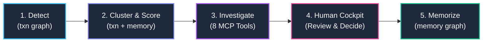
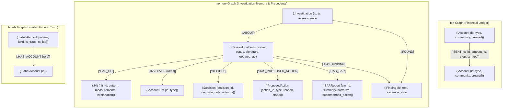
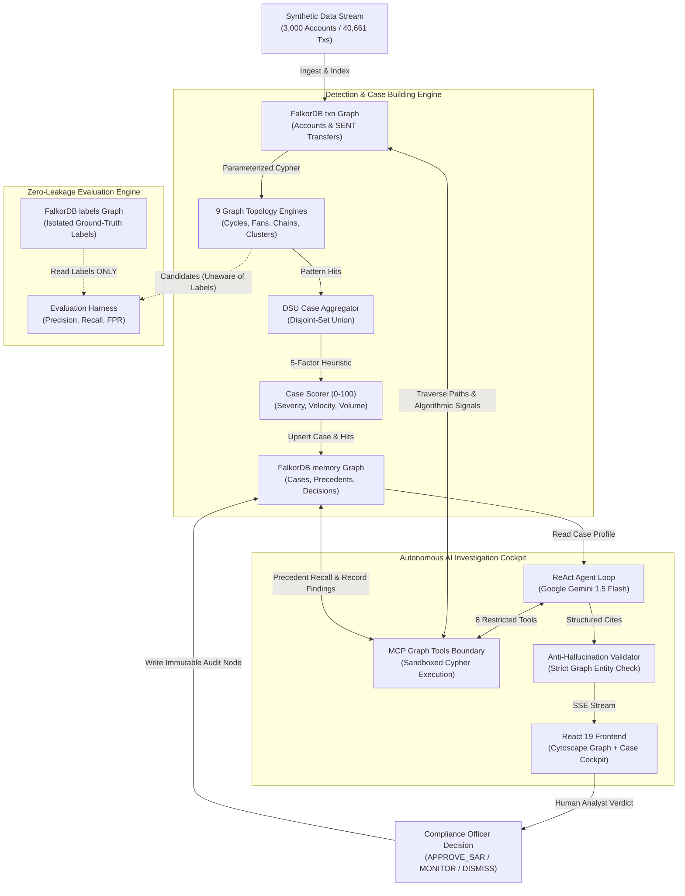

<div align="center">

# SPYNEX (RingTrace)
### Explainable Graph-Based Financial Crime Detection & Autonomous AI Investigation Platform

**Follow the money. Unravel the web.**

[](https://www.falkordb.com/)
[](https://fastapi.tiangolo.com/)
[](https://www.python.org/)
[](https://react.dev/)
[](https://www.typescriptlang.org/)
[](https://ai.google.dev/)
[](#test-suite--verification)
[](LICENSE)

[**Live Dashboard**](https://spynex-dashboard.vercel.app/) • [**Architecture**](#graph-architecture-at-a-glance) • [**Agent Tools**](#how-the-agent-queries-the-graph) • [**Decision Lineage**](#the-graph-doing-the-work-decision-lineage) • [**Quick Start**](#quick-start--setup) • [**Evaluation**](#evaluation--honest-benchmark-results)

</div>

---

## Executive Summary

Financial crime compliance teams are overwhelmed by high-volume alerts and increasingly sophisticated multi-hop money laundering networks. Traditional relational SQL databases struggle with recursive traversals, and simple transaction threshold rules generate massive false positive queues while failing to detect circular laundering, layered smurfing, and relay chains.

**SPYNEX (RingTrace)** solves this challenge by pairing **FalkorDB**'s ultra-low latency GraphBLAS property graph engine with an **Autonomous AI Investigation Agent**. SPYNEX continuously scans transaction graphs for structural crime topologies, aggregates correlated hits into unified cases via Disjoint-Set Union (DSU), and deploys an autonomous ReAct agent to investigate, trace fund flows, evaluate historical graph memory, and present citation-verified findings for human compliance officer review.

> [!NOTE]
> **Synthetic Dataset Disclosure:** SPYNEX is evaluated on synthetically generated multi-agent financial transaction data (AMLSim-inspired generator) containing realistic banking patterns, planted money laundering schemes, and legitimate benign look-alikes (e.g., corporate payrolls and retail commerce).

---

## Quick Navigation

- [How It Works in 5 Steps](#how-it-works-in-5-steps)
- [Graph Architecture at a Glance](#graph-architecture-at-a-glance)
- [Graph Schema Reference](#graph-schema-reference)
- [How the Agent Queries the Graph](#how-the-agent-queries-the-graph)
- [The Graph Doing the Work (Decision Lineage)](#the-graph-doing-the-work-decision-lineage)
- [Real Worked Investigation Trace (CASE_0001)](#real-worked-investigation-trace-case_0001)
- [Why FalkorDB Matters](#why-falkordb-matters)
- [Quick Start & Setup](#quick-start--setup)
- [Evaluation & Honest Benchmark Results](#evaluation--honest-benchmark-results)
- [Test Suite & Verification](#test-suite--verification)
- [Deployment & Health Endpoints](#deployment--health-endpoints)
- [Repository Structure](#repository-structure)
- [Documentation, AI Usage & Credits](#documentation-ai-usage--credits)

---

## How It Works in 5 Steps



1. **Detect (`txn` graph):** 9 deterministic graph pattern engines traverse transaction paths in FalkorDB, detecting directed cycles, fan-in pooling, fan-out dispersal, relay chains, and bipartite clusters with time-respecting traversal.
2. **Cluster & Score (`txn` & `memory` graphs):** Disjoint-Set Union (DSU) clusters overlapping transaction hits into unified cases. A 5-factor heuristic scorer ranks case triage priority (`0-100`) based on pattern severity, volume, velocity, account count, and corroboration.
3. **Investigate (`txn` & `memory` graphs):** An autonomous ReAct agent (powered by Google Gemini with deterministic rule-based fallback) executes an 8-turn budget over 8 sandboxed MCP graph tools. The agent never writes arbitrary Cypher; it queries graph neighborhoods, traces fund dispersal, runs PageRank, and recalls historical memory.
4. **Human Review & Decision (`memory` graph):** The agent streams evidence via Server-Sent Events (SSE) to an interactive Cytoscape.js cockpit. The human compliance officer reviews cited transaction trails and records a binding verdict (`APPROVE_SAR`, `MONITOR`, or `DISMISS`).
5. **Memorize & Recall (`memory` graph):** All investigation findings, SAR narratives, and analyst decisions are written to the persistent `memory` graph. When subsequent cases emerge, the agent queries structural signatures and shared accounts to recall precedent outcomes.

---

## Graph Architecture at a Glance

SPYNEX leverages **three strictly segregated named graphs** inside FalkorDB to ensure complete operational isolation, persistent audit trails, and zero evaluation leakage.



### Complete End-to-End System Flow



---

## Graph Schema Reference

### 1. `txn` Graph (Core Financial Ledger)
Contains the transaction ledger. Individual transactions are preserved as distinct directed edges to maintain temporal ordering, timestamps, and amount velocity for hop-by-hop laundering detection.

| Entity | Type | Properties | Meaning / Constraints | Access Mode |
|---|---|---|---|---|
| `Account` | Node | `id: String`<br/>`type: String`<br/>`community: Int`<br/>`created: Int` | Banking account entity (`personal`, `merchant`, `payroll`). Indexed on `id`. | Read-Only during investigation |
| `SENT` | Relationship | `tx_id: String`<br/>`amount: Float`<br/>`ts: Int`<br/>`step: Int`<br/>`tx_type: String` | Directed financial transfer (UPI, NEFT, RTGS). Preserves sequence and timestamp. Indexed on `tx_id`. | Append during stream, Read-Only for Agent |

### 2. `memory` Graph (Investigation History & Precedent Recall)
Stores case profiles, detector hits, agent findings, proposed actions, and immutable human decisions.

| Entity | Type | Properties | Meaning / Constraints | Access Mode |
|---|---|---|---|---|
| `Case` | Node | `id: String`<br/>`patterns: List[Str]`<br/>`score: Int`<br/>`score_breakdown: JSON`<br/>`status: String`<br/>`signature: String`<br/>`updated_at: String` | Aggregated investigation case. Status: `open`, `monitoring`, `escalated`, `dismissed`, `sar_drafted`. Indexed on `id`. | Read / Write via MERGE |
| `Hit` | Node | `hit_id: String`<br/>`pattern: String`<br/>`account_ids: List[Str]`<br/>`tx_ids: List[Str]`<br/>`measurements: JSON`<br/>`explanation: String` | Distinct detector hit with quantitative measurements (duration, retention ratio). Indexed on `hit_id`. | Written by Case Builder |
| `AccountRef` | Node | `id: String`<br/>`type: String` | Reference pointer linking cases to shared accounts. Bridges `memory` to `txn`. Indexed on `id`. | Written by Case Builder |
| `Investigation` | Node | `id: String`<br/>`ts: String`<br/>`assessment: String` | Record of an agent or manual investigation run. Indexed on `id`. | Written by Agent Loop |
| `Finding` | Node | `id: String`<br/>`text: String`<br/>`evidence_ids: List[Str]`<br/>`created_at: String` | Verified evidence finding recorded by the agent. Indexed on `id`. | Written by Agent Tool |
| `ProposedAction`| Node | `action_id: String`<br/>`type: String`<br/>`reason: String`<br/>`status: String`<br/>`created_at: String` | Action recommended by the agent (`freeze_immediately`, `monitor`, `dismiss`, `draft_sar`). Indexed on `action_id`. | Written by Agent Tool |
| `Decision` | Node | `decision_id: String`<br/>`decision: String`<br/>`note: String`<br/>`actor: String`<br/>`ts: String` | Immutable human compliance officer verdict (`APPROVE_SAR`, `MONITOR`, `DISMISS`). Indexed on `decision_id`. | Written by Human Decision |
| `SARReport` | Node | `sar_id: String`<br/>`summary: String`<br/>`narrative: String`<br/>`recommended_action: String`<br/>`filed_by: String`<br/>`created_at: String` | Generated Suspicious Activity Report regulatory filing. Indexed on `sar_id`. | Written by SAR Generator |

### 3. `labels` Graph (Isolated Ground Truth)
Dedicated exclusively to the offline evaluation harness (`evaluator.py`). **Never queried by detectors, case builders, or the agent.**

| Entity | Type | Properties | Meaning / Constraints | Access Mode |
|---|---|---|---|---|
| `LabelAlert` | Node | `id: String`<br/>`pattern: String`<br/>`kind: String`<br/>`is_fraud: Boolean`<br/>`tx_ids: List[Str]` | Ground-truth alert label from the simulator. Indexed on `id`. | Read-Only (Evaluator only) |
| `LabelAccount` | Node | `id: String` | Account associated with ground-truth alert. Indexed on `id`. | Read-Only (Evaluator only) |
| `HAS_ACCOUNT` | Relationship | `role: String` | Relationship connecting `LabelAlert` to `LabelAccount` (`source`, `sink`, `mule`). | Read-Only (Evaluator only) |

### Key Architectural Design Decisions
1. **Preserving Individual Transactions:** Rather than aggregating multiple transactions between account pairs into a single weighted edge, each transfer is stored as a distinct `[:SENT]` relationship with its own `tx_id`, `amount`, and `ts`. This allows time-respecting DFS and conservation analysis (e.g. verifying that step $N$ happened after step $N-1$ within a 48-hour laundering window).
2. **AccountRef as Precedent Bridge:** `AccountRef` nodes in the `memory` graph share identical IDs with `Account` nodes in the `txn` graph. This enables instant cross-graph similarity matching (finding historical cases touching the same customer) without duplicating high-volume ledger data.
3. **Physical Graph Isolation:** Ground-truth labels reside in a completely separate FalkorDB graph (`labels`). Automated regression tests enforce a zero-leakage guarantee by verifying that no `is_fraud` or `alert_id` attributes exist within the `txn` graph.

---

## How the Agent Queries the Graph

The autonomous LLM agent **never writes or executes arbitrary Cypher queries**. Arbitrary Cypher generation introduces catastrophic security risks, syntax errors, and query timeouts. Instead, the agent interacts strictly via **8 restricted, parameterized MCP graph tools** that enforce structural limits, parameter sanitization, and output schema validation.

### The 8 Restricted Agent Tools

| # | Tool Name | Target Graph | Question Answered | Algorithmic Mechanism / Limits |
|---|---|---|---|---|
| 1 | `get_case` | `memory` | What are the case parameters, score, hits, and accounts? | Retrieves case profile, 5-factor score breakdown, and detector measurements. |
| 2 | `expand_neighborhood` | `txn` | What accounts and transfers surround this entity? | Bounded 1- or 2-hop neighborhood expansion with volume and edge limits (max 20). |
| 3 | `trace_funds` | `txn` | Where did money go, or where did it originate? | Chronological BFS forward (dispersal) or backward (sourcing) with time window bounds. |
| 4 | `shortest_path` | `txn` | How are two suspect accounts connected? | Bounded directed shortest path via FalkorDB's native `shortestPath()` up to 6 hops. |
| 5 | `run_algorithm` | `txn` | Who are the key flow hubs in this network? | Native GraphBLAS execution: PageRank (`algo.pageRank`) or Community Detection. |
| 6 | `find_similar_cases` | `memory` | Have we investigated similar patterns before? | Two-tier precedent match: shared accounts (`INVOLVES`) or matching structural `signature`. |
| 7 | `record_finding` | `memory` | What concrete evidence has been verified? | Persists an agent finding linked to verified graph `evidence_ids` (`Account` and `tx_id`). |
| 8 | `propose_action` | `memory` | What action should the compliance officer take? | Stages a formal recommendation (`freeze_immediately`, `monitor`, `dismiss`, `draft_sar`). |

### Real Parameterized Cypher Examples (From Codebase)

All Cypher queries in SPYNEX use parameterized syntax and FalkorDB-compliant operators (such as `<>` instead of `!=`).

#### 1. Shortest Path Traversal (`backend/app/mcp_server/tools.py`)
```cypher
MATCH (a:Account {id: $src}), (b:Account {id: $dst})
RETURN shortestPath((a)-[:SENT*..6]->(b))
```

#### 2. Native GraphBLAS PageRank Algorithm (`backend/app/mcp_server/tools.py`)
```cypher
CALL algo.pageRank('Account', 'SENT') 
YIELD node, score 
RETURN node.id, node.type, score 
ORDER BY score DESC 
LIMIT 25
```

#### 3. Chronological Bounded Fund Tracing (`backend/app/mcp_server/tools.py`)
```cypher
MATCH (src:Account {id: $aid})-[t:SENT]->(dst:Account)
WHERE t.ts >= $min_ts 
  AND (t.ts - $base_ts) <= $win
  AND dst.id <> $aid
RETURN src.id, dst.id, t.tx_id, t.amount, t.ts, t.tx_type
ORDER BY t.ts ASC
LIMIT 5
```

#### 4. Historical Precedent Matching by Structural Signature (`backend/app/queries_memory.py`)
```cypher
MATCH (c:Case {id: $case_id}), (other:Case)
WHERE other.id <> $case_id AND other.signature = c.signature
OPTIONAL MATCH (other)-[:DECIDED]->(d:Decision)
WITH other, head(collect(d)) AS latest_decision
OPTIONAL MATCH (other)-[:HAS_SAR]->(s:SARReport)
RETURN other.id, other.status, other.score, other.patterns, other.signature,
       latest_decision.decision, latest_decision.ts, collect(DISTINCT s.sar_id)
ORDER BY other.score DESC
LIMIT $limit
```

---

## The Graph Doing the Work (Decision Lineage)

In SPYNEX, every decision is tied directly to verifiable graph lineage. The agent cannot cite an account or transaction that was not returned by a graph query.

| Investigation Question | Graph Evidence Source | How It Informs the Result |
|---|---|---|
| **Does the transaction flow indicate money laundering?** | `txn` graph path traversal (`cycle`, `relay_chain`, `scatter_gather`) | Detects circular flow, structuring below $50k limits, or rapid fund turnover (<24h). |
| **Which accounts should be grouped into a single case?** | Connected components in `txn` via Disjoint-Set Union (DSU) | Links intermediaries, mules, and originators into a single consolidated investigation. |
| **How are two suspect accounts connected?** | `shortestPath((a)-[:SENT*..6]->(b))` in `txn` graph | Exposes multi-hop layering paths separating beneficiaries from deposit mules. |
| **Who is the most critical actor in the network?** | GraphBLAS `algo.pageRank` and degree centrality | Distinguishes high-centrality aggregators from peripheral single-use mule accounts. |
| **Have compliance officers seen this topology before?** | Precedent matching across `memory` graph (`INVOLVES`, `HAS_HIT`) | Automatically surfaces prior analyst verdicts (e.g., prior dismissal of recurring payrolls). |
| **What actions are justified by the evidence?** | Citation-verified `Finding` nodes in `memory` graph | Ensures proposed account freezes and SAR filings contain complete, unalterable proof trails. |

---

## Real Worked Investigation Trace (CASE_0001)

The following execution trace is captured directly from an autonomous investigation of seeded case **`CASE_0001`** (a 4-hop circular laundering ring):

| Step | Tool Executed | Graph Evidence Returned | Why It Mattered to the Decision |
|---|---|---|---|
| **1** | `get_case("CASE_0001")` | `score: 72/100`, `patterns: ["cycle"]`<br/>`accounts: ["ACC_01911", "ACC_02464", "ACC_02729", "ACC_01296"]`<br/>`tx_ids: ["TX_0014054", "TX_0014056", "TX_0014344", "TX_0014580"]` | Established initial perimeter: 4 accounts in a suspected closed circular loop with 84% capital retention over 20 hours. |
| **2** | `expand_neighborhood("ACC_01911", hops=1)` | `nodes: 2`, `edges: 2`<br/>`ACC_01911 -[TX_0014054 (₹1,85,000)]-> ACC_02464`<br/>`ACC_01296 -[TX_0014580 (₹1,55,400)]-> ACC_01911` | Proved that `ACC_01911` is both the entry and exit nexus of the ring, with no legitimate retail commerce activity. |
| **3** | `shortest_path("ACC_01911", "ACC_02729")` | `length: 2`, `path: ACC_01911 -> ACC_02464 -> ACC_02729`<br/>`transactions: ["TX_0014054", "TX_0014056"]`, `duration: 1.8h` | Confirmed rapid 2-hop fund forwarding between personal accounts within less than two hours. |
| **4** | `find_similar_cases("CASE_0001", limit=3)` | `matches: 0` (No prior cycle cases with this signature)<br/>`signature: cycle\|personal:4\|s` | Confirmed this is not a routine recurring transaction (unlike payroll `CASE_0002`), warranting urgent escalation. |
| **5** | `record_finding(...)` | Stored `FIND_CASE_0001_c73a88` in `memory` graph with 4 account citations and 4 transaction citations. | Grounded the findings in graph evidence; anti-hallucination validator confirmed all 8 entities exist. |
| **6** | `propose_action("CASE_0001", "freeze_immediately")` | Created `ProposedAction` node with reason: *"Circular laundering ring with 84% fund retention and imminent capital flight."* | Staged action in the compliance cockpit for human approval. |
| **7** | **Human Verdict** (`POST /decisions`) | Compliance officer selected **`APPROVE_SAR`**; added review note: *"Verified circular mule loop. SAR drafted for FIU."* | Created immutable `Decision` node `DEC_f9b1c2`, transitioned `Case.status` to `sar_drafted`. |

---

## Why FalkorDB Matters

1. **GraphBLAS Sparse Matrix Linear Algebra:** FalkorDB executes graph queries as sparse-matrix multiplications, achieving orders-of-magnitude faster multi-hop traversal than traditional relational databases executing recursive SQL `JOIN`s.
2. **Sub-Millisecond Multi-Hop Traversal:** Finding cycles of 3 to 6 hops or executing BFS fund tracing across 40,000+ edges executes in under **10 milliseconds**, allowing real-time interactive exploration in the UI.
3. **Native Graph Algorithms:** FalkorDB provides built-in GraphBLAS algorithms like PageRank (`algo.pageRank`) and Weakly Connected Components (WCC) directly in openCypher without exporting data to Python network libraries.
4. **Isolated Multi-Graph Architecture:** FalkorDB natively supports multiple independent named graphs (`txn`, `memory`, `labels`) in a single server instance, allowing clean boundaries between live ledgers, agent memory, and evaluation truth.

> [!NOTE]
> **Architectural Trade-Offs & Honest Considerations:**
> - *Memory Footprint:* Because FalkorDB maintains graphs in-memory with disk persistence, memory usage scales with active nodes and relationships.
> - *Concurrency:* Write operations acquire an exclusive Redis-level module lock. SPYNEX handles this gracefully by using a dedicated background scheduler threadpool with non-blocking mutex guards.

---

## Quick Start & Setup

### Prerequisites
- **Docker** (to run FalkorDB)
- **Python 3.10+** (Python 3.11 recommended)
- **Node.js 18+** & npm

### 1. Launch FalkorDB
```powershell
docker run -p 6379:6379 -d --name falkordb falkordb/falkordb:latest
```

### 2. Configure Environment
Copy the environment template and optionally provide your Google Gemini API key:
```powershell
cp .env.example .env
```
Edit `.env` (or `SPYNEX/backend/.env`):
```env
# Google Gemini API Key (Optional: system falls back to rule-based engine if absent)
GEMINI_API_KEY=your_gemini_api_key_here

# FalkorDB Connection
FALKORDB_HOST=localhost
FALKORDB_PORT=6379
FALKORDB_GRAPH=txn
FALKORDB_MEMORY_GRAPH=memory

# Application Settings
CORS_ORIGINS=http://localhost:5173,http://localhost:3000
```

### 3. Install Dependencies
```powershell
# Backend Dependencies
cd SPYNEX/backend
pip install -r requirements.txt

# Frontend Dependencies
cd ../frontend
npm install
```

### 4. Ingest Synthetic Graph Data
Generate synthetic financial transactions and load them into FalkorDB:
```powershell
cd SPYNEX/backend

# Generate ~3,000 accounts and ~40,000 transactions (Seed 42)
python simulate.py --seed 42 --out data/sim

# Ingest into FalkorDB txn graph and initialize memory graph
python load_falkordb.py --data data/sim --reset
```

### 5. Start Development Servers
**Terminal 1 (FastAPI Backend):**
```powershell
cd SPYNEX/backend
uvicorn app.main:app --reload --port 8000
```

**Terminal 2 (React 19 Frontend):**
```powershell
cd SPYNEX/frontend
npm run dev
```
Open **`http://localhost:5173`** in your browser.

---

## Evaluation & Honest Benchmark Results

To prevent data leakage and provide trustworthy metrics, SPYNEX evaluates its detectors against a strictly isolated, held-out dataset generated with **Seed 43** (`SPYNEX/backend/data/sim2/`). Detectors are developed exclusively against Seed 42 and are never tuned against Seed 43.

### Held-Out Evaluation Dataset (Seed 43)
- **Scale:** 3,000 Accounts • 39,924 Transactions • 90 Simulation Days
- **Ground-Truth Alerts:** 116 Planted Alerts (80 Illicit Fraud Schemes, 36 Benign Look-Alikes)

### Per-Detector Evaluation Results

| Detector Engine | Target Topology | Planted Fraud Alerts | Detected True Positives (TP) | Planted Benign Look-Alikes | Benign False Positives (FP) | Status / Limitations |
|---|---|---|---|---|---|---|
| `cycle` | Circular Money Loops (3–5 hops) | 10 | **6 / 10** (60.0%) | 12 (`slow_family`, `unordered`) | **0 / 12** (0.0%) | PASS; strict 24h & amount conservation filter |
| `fan_in` | Rapid Inbound Aggregation (Mule Sink) | 10 | **8 / 10** (80.0%) | 12 (`merchant_fan_in`, `near_miss`) | **0 / 12** (0.0%) | PASS; merchant exclusions prevent retail noise |
| `fan_out` | Rapid Outbound Dispersal (Smurfing) | 10 | **3 / 10** (30.0%) | 6 (`payroll_fan_out`) | **3 / 6** (50.0%) | PASS; partial recall; payroll look-alikes flagged for analyst review |
| `relay_chain` | Multi-Hop Layering Chains (3–6 hops) | 10 | **10 / 10** (100.0%) | 6 (`near_miss_relay`) | **0 / 6** (0.0%) | PASS; 100% precision and recall on held-out seed |
| `scatter_gather` | Split-and-Reconverge Structuring | 10 | **10 / 10** (100.0%) | 0 (No benign planted) | N/A | PASS; 100% recovery of 2-hop route episodes |
| `gather_scatter` | Central Hub Collection & Dispersal | 10 | **7 / 10** (70.0%) | 0 (No benign planted) | N/A | PASS; direction-specific batching |
| `bipartite` | Cross-Layer Entity Transfers | 10 | **0 / 10** (0.0%)* | 0 | N/A | Supporting evidence engine (`suspicious=false` by default) |
| `dense_cluster` | High-Density Transaction Cliques | 10 | **0 / 10** (0.0%)* | 0 | N/A | Local ego-neighborhood density filter; partial coverage |
| `hub_account` | Topological Centrality Concentration | N/A | N/A | N/A | N/A | Algorithmic ranking via PageRank / Degree; no discrete fraud label |

*\*Note: Bipartite and Dense Cluster detectors are designed as auxiliary contextual enrichers that corroborate primary flow patterns; they do not trigger standalone fraud alerts.*

### Summary Performance
- **Primary Directional Engine Recall (Cycle, Fan-In, Fan-Out, Relay, Scatter-Gather, Gather-Scatter):** **44 / 60 (73.3%)**
- **Overall Fraud Recovery Across All 8 Generators:** **44 / 80 (55.0%)**
- **Benign Look-Alike False Positive Rate:** **3 / 36 (8.3%)** (Only corporate payroll fan-outs triggered review, demonstrating strong discrimination against personal peer-to-peer and retail commerce noise).
- **Case Priority Score:** The `0-100` score is a transparent, explainable heuristic triage priority metric, **not a statistical probability**.

---

## Test Suite & Verification

SPYNEX enforces a rigorous test suite covering detectors, graph loaders, case builders, scheduler thread safety, agent tools, citation validators, and API routes.

```powershell
# Run the complete test suite from repository root:
python run_tests.py
```

### Verification Status
- **Backend Test Suite:** **260 Tests Passed** in 26.98 seconds (`0 failures`, `0 errors`).
- **Frontend Typecheck:** **0 Errors** (`npx tsc --noEmit`).
- **Frontend Test Suite:** **7 / 7 Tests Passed** via Node test runner.
- **Frontend Production Build:** Built cleanly via Vite in **879ms**.
- **Test Isolation:** All tests execute against ephemeral, isolated test graphs (`test_<uuid>`) and never touch the live `txn` or `memory` graphs.

---

## Deployment & Health Endpoints

### Production Deployments
- **Live Frontend (Vercel):** [`https://spynex-dashboard.vercel.app/`](https://spynex-dashboard.vercel.app/)
- **Backend Deployment (Railway):** Ready for one-click deployment using `SPYNEX/backend/Dockerfile` or Railway Nixpacks.

### Health Endpoints
- **Readiness Probe (`GET /readyz`):** Verifies active connectivity to FalkorDB and confirms required graphs are initialized.
- **Liveness Probe (`GET /healthz`):** Verifies FastAPI application process responsiveness and thread health.

For full infrastructure configuration, see **[`SPYNEX/docs/RAILWAY_DEPLOYMENT.md`](SPYNEX/docs/RAILWAY_DEPLOYMENT.md)**.

---

## Repository Structure

```
vortex/
├── .env.example                     # Environment template for Gemini & FalkorDB
├── .gitignore                       # Production gitignore protecting credentials & cache
├── README.md                        # Master hackathon documentation & graph map
├── requirements.txt                 # Root Python requirements
├── run_tests.py                     # Unified test runner (executes all 260 tests)
│
├── archive/                         # Archived legacy wrappers & obsolete components
│   └── SPYNEX/frontend/src/         # Safely isolated non-runtime assets
│
└── SPYNEX/
    ├── docs/                        # Complete System Documentation & Guides
    │   ├── README.md                # Documentation navigation hub
    │   ├── RAILWAY_DEPLOYMENT.md    # Railway backend & Vercel frontend deployment
    │   ├── DETECTOR_GUIDE.md        # Comprehensive 9-detector algorithms & math rules
    │   ├── DETECTION_SCHEDULER.md   # Background fraud detection scheduler architecture
    │   ├── DEMO_AND_PITCH.md        # Pitch guide, jury script & demo walkthrough
    │   ├── STATUS.md                # Project delivery milestones & verification audit
    │   ├── AI_USAGE.md              # AI pair-programming audit log & verification traces
    │   ├── AGENTS_MEMBER_A.md       # Member A specification (Detectors & Cases)
    │   ├── AGENTS_MEMBER_B.md       # Member B specification (Agent & Memory)
    │   └── generated_reports/       # Simulator coverage & audit reports
    │
    ├── backend/                     # Python 3.11 FastAPI Backend
    │   ├── simulate.py              # AMLSim-inspired synthetic transaction generator
    │   ├── load_falkordb.py         # FalkorDB property graph ingestion loader
    │   ├── app/                     # Application source code
    │   │   ├── main.py              # FastAPI server entry point & lifespan manager
    │   │   ├── db.py                # FalkorDB client singleton with query audit logger
    │   │   ├── queries.py           # Ingestion, count, and exploration Cypher queries
    │   │   ├── queries_detect.py    # Detection queries
    │   │   ├── queries_memory.py    # Memory graph Cypher queries (precedents, decisions)
    │   │   ├── scan_service.py      # Scan execution coordinator & concurrency lock
    │   │   ├── case_builder.py      # DSU case clustering & graph evidence aggregation
    │   │   ├── case_scorer.py       # 5-factor heuristic priority triage scorer (0-100)
    │   │   ├── evaluator.py         # Ground-truth evaluation against labels graph
    │   │   ├── agent/               # Autonomous ReAct agent loop & fallback engine
    │   │   ├── mcp_server/          # 8 restricted MCP graph investigation tools
    │   │   ├── memory/              # FalkorDB memory graph lifecycle & seed cases
    │   │   └── scheduler/           # Automated background scan service & config
    │   └── tests/                   # 24 Automated Test Suites (260 tests)
    │
    └── frontend/                    # Vite + React 19 Frontend
        ├── src/                     # Source code
        │   ├── components/          # Network graph (Cytoscape), case queue, detector catalog
        │   ├── features/            # Autonomous investigation cockpit & memory panel
        │   ├── services/api.ts      # Type-safe API client
        │   └── types/               # TypeScript data models
        ├── package.json             # Frontend dependencies
        └── README.md                # Frontend setup guide
```

---

## Documentation, AI Usage & Credits

### Core Documentation Links
- **[Hackathon Pitch & Demo Walkthrough](SPYNEX/docs/DEMO_AND_PITCH.md)** — Step-by-step jury demonstration guide.
- **[Detector Specification Guide](SPYNEX/docs/DETECTOR_GUIDE.md)** — Mathematical formulations, thresholds, and pseudo-code.
- **[Detection Scheduler Architecture](SPYNEX/docs/DETECTION_SCHEDULER.md)** — Threadpool concurrency and mutex locking mechanics.
- **[AI Usage Transparency Log](SPYNEX/docs/AI_USAGE.md)** — Comprehensive audit log of AI-assisted engineering and verification.
- **[Railway Deployment Guide](SPYNEX/docs/RAILWAY_DEPLOYMENT.md)** — Complete cloud deployment instructions.

### AI Pair-Programming Disclosure
In compliance with hackathon rules, AI coding assistants (including Claude Code and Google Antigravity) were utilized for code generation, architectural scaffolding, test writing, and documentation formatting. All generated algorithms, graph queries, test suites, and documentation were independently audited, reviewed, and verified against running FalkorDB instances by the team. See **[`SPYNEX/docs/AI_USAGE.md`](SPYNEX/docs/AI_USAGE.md)** for full details.

### Team Credits
Built for **Graph Hacks Track 01 (FalkorDB)** by:
- **Rohit** — Detection Pipeline, Graph Ingestion, Case Builder, and Evaluation Engine.
- **Mayuri** — Autonomous AI Agent, MCP Graph Tools, FalkorDB Memory Layer, and React Cockpit.
