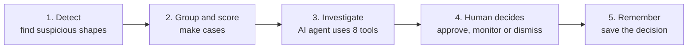
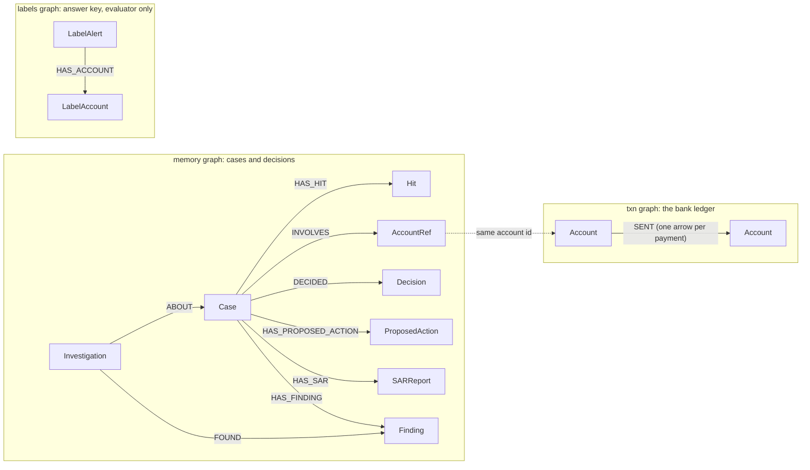
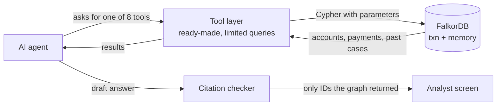

<div align="center">

# SPYNEX 

### An AI investigator that follows the money through a graph database

**Follow the money. Unravel the web.**

[](https://www.falkordb.com/)
[](https://fastapi.tiangolo.com/)
[](https://www.python.org/)
[](https://react.dev/)
[](https://ai.google.dev/)

[**Live Dashboard**](https://spynex-dashboard.vercel.app/) • [**The Graph Map**](#the-graph-map) • [**How the Agent Asks the Graph**](#how-the-agent-asks-the-graph) • [**The Graph Does the Work**](#the-graph-does-the-work) • [**Quick Start**](#quick-start) • [**Results**](#how-well-does-it-work)

</div>

---

## What is this?

Money launderers do not move dirty money in one simple transfer. They pass it through many accounts, send it in circles, and split it into small pieces so nobody notices. A normal table of transactions makes these tricks hard to see. A **graph** makes them easy to see, because a graph is just accounts (dots) connected by payments (arrows).

**SPYNEX** does four things:

1. **Finds** suspicious shapes in the payment graph (circles, fans, chains).
2. **Groups** related findings into one **case** and gives it a priority score from 0 to 100.
3. **Investigates** the case with an AI agent that can only use eight safe, limited tools to look at the graph.
4. **Remembers** what the human analyst decided, so the next similar case gets help from the past.

A human always makes the final decision. The AI only suggests.

> [!NOTE]
> **All data is synthetic.** We generated our own fake bank (3,000 accounts and about 40,000 payments) with money-laundering patterns **and** harmless look-alikes (like company payroll). No real customer data is used anywhere. Our results show how the method works on this fake data, not how it would do at a real bank.

---

## How it works in 5 steps



| Step | What happens | Graph used |
|---|---|---|
| 1. Detect | 9 detection engines search the payments for cycles, fan-in, fan-out, relay chains and more | `txn` |
| 2. Group and score | Findings that share an account are joined into one case (using a standard grouping method called Disjoint-Set Union). A 5-part score ranks which case to look at first. The score is a priority, **not a probability** | `txn` and `memory` |
| 3. Investigate | An AI agent (Google Gemini) picks tools one at a time. It can never write its own database queries | `txn` and `memory` |
| 4. Human decides | The analyst sees every step live, checks the cited evidence, and chooses `APPROVE_SAR`, `MONITOR` or `DISMISS` | `memory` |
| 5. Remember | The finding, the decision and any report draft are saved, so the agent can say "we saw something like this before" | `memory` |

---

## The graph map

We use **three separate graphs** inside one FalkorDB database. Keeping them apart keeps things clean and honest.



**Reading the diagram:** a box is a *node* (a thing). An arrow is a *relationship* (how two things are connected). `AccountRef` in `memory` has the same ID as the `Account` in `txn`, which is how a past case is linked to the live ledger without copying it.

### 1. `txn` graph: the bank ledger

| Item | Kind | Main properties | In plain words |
|---|---|---|---|
| `Account` | Node | `id`, `type`, `community`, `created` | A bank account. Type is `personal`, `merchant` or `payroll` |
| `SENT` | Relationship | `tx_id`, `amount`, `ts`, `step`, `tx_type` | One payment from one account to another (UPI, NEFT, IMPS or RTGS) |

Every payment is its **own arrow**. We never merge payments between the same two accounts, because we need the exact time and amount of each one to tell if money moved in order.

### 2. `memory` graph: cases and decisions

| Item | Main properties | In plain words |
|---|---|---|
| `Case` | `id`, `patterns`, `score`, `score_breakdown`, `status`, `signature` | One investigation file. Status is `open`, `monitoring`, `escalated`, `dismissed` or `sar_drafted` |
| `Hit` | `hit_id`, `pattern`, `account_ids`, `tx_ids`, `measurements`, `explanation` | One thing a detector found, with its numbers |
| `AccountRef` | `id`, `type` | A pointer to an account in the ledger |
| `Investigation` | `id`, `ts`, `assessment` | One run of the AI agent |
| `Finding` | `id`, `text`, `evidence_ids` | A fact the agent recorded, with the account and payment IDs that prove it |
| `ProposedAction` | `action_id`, `type`, `reason`, `status` | What the agent suggests (for example `monitor`, `dismiss`, `draft_sar`) |
| `Decision` | `decision_id`, `decision`, `note`, `actor`, `ts` | The human's verdict. We add a new one each time and never edit old ones |
| `SARReport` | `sar_id`, `summary`, `narrative`, `recommended_action` | A **draft** Suspicious Activity Report. It is a demo document on fake data and is not filed with anyone |

### 3. `labels` graph: the answer key

| Item | Main properties | In plain words |
|---|---|---|
| `LabelAlert` | `id`, `pattern`, `kind`, `is_fraud`, `tx_ids` | A crime or look-alike that our simulator planted on purpose |
| `LabelAccount` | `id` | An account that belongs to a planted alert |
| `HAS_ACCOUNT` | `role` | Links an alert to its accounts |

**This graph is only for grading.** Detectors, the case builder and the AI agent never read it. A test checks that no answer-key fields (`is_fraud`, `alert_id`) ever appear in the `txn` graph.

---

## How the agent asks the graph

The AI agent **never writes database queries.** If it did, one bad query could slow down or damage the database, and AI models often invent field names that do not exist. Instead the agent can only call **eight fixed tools**. Each tool runs a ready-made query with limits on how far it can search and how many rows it can return.



### The 8 tools

| # | Tool | Graph | The question it answers |
|---|---|---|---|
| 1 | `get_case` | `memory` | What is in this case: score, findings, accounts? |
| 2 | `expand_neighborhood` | `txn` | Who is this account directly connected to? (limited to a small area) |
| 3 | `trace_funds` | `txn` | Where did the money go next, or where did it come from? (inside a time window) |
| 4 | `shortest_path` | `txn` | How are these two accounts connected? (up to 6 steps) |
| 5 | `run_algorithm` | `txn` | Which account is the central hub? (PageRank or community detection built into FalkorDB) |
| 6 | `find_similar_cases` | `memory` | Have we seen a case like this before, and what was decided? |
| 7 | `record_finding` | `memory` | Save a proven fact with its evidence IDs |
| 8 | `propose_action` | `memory` | Suggest what the analyst should do |

### Real queries from the code

These are copied from the codebase. Note the `$parameters` and `LIMIT`: queries are always bounded. FalkorDB uses `<>` for "not equal", not `!=`.

**Shortest path between two accounts** (`backend/app/mcp_server/tools.py`)

```cypher
MATCH (a:Account {id: $src}), (b:Account {id: $dst})
RETURN shortestPath((a)-[:SENT*..6]->(b))
```

**Who is the most central account?** (`backend/app/mcp_server/tools.py`)

```cypher
CALL algo.pageRank('Account', 'SENT')
YIELD node, score
RETURN node.id, node.type, score
ORDER BY score DESC
LIMIT 25
```

**Follow the money forward, in time order** (`backend/app/mcp_server/tools.py`)

```cypher
MATCH (src:Account {id: $aid})-[t:SENT]->(dst:Account)
WHERE t.ts >= $min_ts
  AND (t.ts - $base_ts) <= $win
  AND dst.id <> $aid
RETURN src.id, dst.id, t.tx_id, t.amount, t.ts, t.tx_type
ORDER BY t.ts ASC
LIMIT 5
```

**Find an earlier, similar case and what was decided** (`backend/app/queries_memory.py`)

```cypher
MATCH (c:Case {id: $case_id}), (other:Case)
WHERE other.id <> $case_id AND other.signature = c.signature
OPTIONAL MATCH (other)-[:DECIDED]->(d:Decision)
WITH other, head(collect(d)) AS latest_decision
OPTIONAL MATCH (other)-[:HAS_SAR]->(s:SARReport)
RETURN other.id, other.status, other.score, other.patterns, other.signature,
       latest_decision.decision, latest_decision.ts, collect(DISTINCT s.sar_id)
ORDER BY other.score DESC
LIMIT $limit
```

### Two safety layers around the agent

1. **Citation checker.** Before an analyst sees the agent's write-up, the checker pulls out every account ID (`ACC_...`) and payment ID (`TX_...`) it mentions. If even one was **not** returned by a tool during that investigation, the answer is rejected.
2. **Fallback.** If the AI fails, times out or runs out of turns, a fixed, no-AI routine runs the same graph tools and fills a plain template. The screen shows a badge so you can see which mode produced the report. If no Gemini key is set, the fallback is used automatically.

---

## The graph does the work

Every decision in SPYNEX can be traced back to something FalkorDB returned. The agent cannot mention an account or payment that the graph did not give it.

| The question | Where the answer comes from | How it helps |
|---|---|---|
| Is money moving in a suspicious shape? | Path searches on the `txn` graph (cycles, relay chains, scatter-gather) | Finds circular flows, payments just under the reporting limit, and very fast hand-offs |
| Which findings belong together? | Accounts shared between findings, saved as `Case` and `AccountRef` in `memory` | Puts the mules and the origin in one case instead of many alerts |
| How are two accounts linked? | `shortestPath` on `txn` | Shows the hidden middle steps between two suspects |
| Who is the key player? | PageRank inside FalkorDB | Separates a busy hub from a one-time pass-through account |
| Have we seen this before? | `memory` graph: shared accounts and the case signature | Brings up earlier analyst decisions, for example a recurring payroll that was dismissed |
| What are we allowed to claim? | `Finding` nodes plus the citation checker | Every claim is backed by IDs that really exist |

### A real example: CASE_0001

This is a run of the agent on the seeded case `CASE_0001`, a circular laundering ring.

| Step | Tool | What the graph returned | Why it mattered |
|---|---|---|---|
| 1 | `get_case("CASE_0001")` | Score 72/100, pattern `cycle`, 4 accounts (`ACC_01911`, `ACC_02464`, `ACC_02729`, `ACC_01296`), 4 payments | A suspected closed loop with about 84% of the money kept, over about 20 hours |
| 2 | `expand_neighborhood("ACC_01911", hops=1)` | 2 accounts, 2 payments: `ACC_01911` to `ACC_02464` (₹1,85,000) and `ACC_01296` to `ACC_01911` (₹1,55,400) | `ACC_01911` is both where the ring starts and where it ends |
| 3 | `shortest_path("ACC_01911", "ACC_02729")` | 2 steps through `ACC_02464`, about 1.8 hours | Money was passed on fast between personal accounts |
| 4 | `find_similar_cases("CASE_0001")` | 0 matches for signature `cycle\|personal:4\|s` | Not a routine repeat like payroll case `CASE_0002`, so it deserves attention |
| 5 | `record_finding(...)` | Saved `FIND_CASE_0001_c73a88` with 4 account IDs and 4 payment IDs | Citation checker confirmed all 8 IDs exist in the graph |
| 6 | `propose_action("CASE_0001", "freeze_immediately")` | A `ProposedAction` node with the reason "circular ring with about 84% of funds retained" | Waits for a human to approve |
| 7 | Human decision (`POST /decisions`) | Analyst chose `APPROVE_SAR` with a note; saved as `Decision` `DEC_f9b1c2`; case status became `sar_drafted` | The final call is always human |

**If the AI is not available:** the fallback runs the same kind of tool calls (look at the neighbourhood, rank accounts with PageRank, check similar cases) and fills a template. The answer still comes from the graph.

**The memory story:** a monthly company payroll looks like a "fan-out" (one account paying many). An analyst dismisses it once with a note. Next month, a similar case appears, and `find_similar_cases` finds the earlier decision and the agent cites it. That is the graph remembering.

---

## Why FalkorDB

FalkorDB is a graph database. Its own documentation says it stores the graph as sparse matrices and uses the GraphBLAS library, so walking the graph is done with matrix math. It also keeps the graph in memory. You can read more in the [FalkorDB design docs](https://docs.falkordb.com/design).

What that gave us in practice:

- **Questions that are naturally graph questions.** "Does money return to where it started within 3 to 5 steps?" is one query, not a pile of table joins.
- **Algorithms inside the database.** PageRank and connected components are built in, so we did not export data to another tool.
- **Many graphs in one server.** `txn`, `memory` and `labels` live side by side and stay separate.
- **Fast small lookups.** From our own query log (`SPYNEX/docs/generated_reports/QUERY_LOG.md`), searching for cycles on a graph of about 40,000 payments took about 7.7 ms (3 steps), 12.9 ms (4 steps) and 93 ms (5 steps).

Honest limits:

- A full sweep of one detector over the whole graph took about 8 to 9 seconds in our evaluation, so scans run **in the background** and not on every tiny update.
- The graph lives in memory, so it has to fit in RAM.
- FalkorDB does not accept `!=` in Cypher (use `<>`), so every query has to be tested against it.
- We did not benchmark against other databases, so we make no "faster than X" claims.

---

## Quick start

**You need:** Docker, Python 3.10 or newer (3.11 recommended), and Node.js 18 or newer.

**1. Start FalkorDB**

```powershell
docker run -p 6379:6379 -d --name falkordb falkordb/falkordb:latest
```

**2. Set up your environment file**

```powershell
cp .env.example .env
```

Open `.env` (or `SPYNEX/backend/.env`) and fill in:

```env
# Optional: without a key, the app uses the no-AI fallback investigator
GEMINI_API_KEY=your_gemini_api_key_here

# FalkorDB connection
FALKORDB_HOST=localhost
FALKORDB_PORT=6379
FALKORDB_GRAPH=txn
FALKORDB_MEMORY_GRAPH=memory

# Allowed website addresses
CORS_ORIGINS=http://localhost:5173,http://localhost:3000
```

For a public deployment, also set the other variables listed in `.env.example` (for example the demo key that protects write actions). Never commit your real `.env` file.

**3. Install**

```powershell
cd SPYNEX/backend
pip install -r requirements.txt

cd ../frontend
npm install
```

**4. Create and load the fake bank data**

```powershell
cd SPYNEX/backend

# make about 3,000 accounts and 40,000 payments (seed 42)
python simulate.py --seed 42 --out data/sim

# load them into FalkorDB and set up the memory graph
python load_falkordb.py --data data/sim --reset
```

**5. Run the app**

Terminal 1 (backend):

```powershell
cd SPYNEX/backend
uvicorn app.main:app --reload --port 8000
```

Terminal 2 (frontend):

```powershell
cd SPYNEX/frontend
npm run dev
```

Open **http://localhost:5173**. Pick a case, press **Run Investigation**, and watch the steps appear.

---

## How well does it work?

We built and tuned all detectors on one fake dataset (seed 42). Then we tested on a **new dataset they had never seen** (seed 43). The test set has 3,000 accounts, 39,924 payments and 116 planted scenarios: **80 real schemes and 36 harmless look-alikes**.

| Detector | What it looks for | Schemes caught | Harmless look-alikes wrongly flagged | Notes |
|---|---|---|---|---|
| `cycle` | Money going in a circle (3 to 5 steps) | 6 of 10 (60%) | 0 of 12 | Strict rules: fast, in order, most money kept |
| `fan_in` | Many accounts paying one account | 8 of 10 (80%) | 0 of 12 | Ignores normal merchant traffic |
| `fan_out` | One account paying many | 3 of 10 (30%) | 3 of 6 | Our weakest. It flags payroll runs for a human to check |
| `relay_chain` | A chain of accounts passing money on quickly | 10 of 10 (100%) | 0 of 6 | |
| `scatter_gather` | Money splits out, then meets again | 10 of 10 (100%) | none planted | No look-alikes planted, so "no false alarms" means little here |
| `gather_scatter` | Many pay a hub, the hub pays many | 7 of 10 (70%) | none planted | Same caution as above |
| `bipartite` | Two groups paying each other densely | 0 of 10 | none planted | Helper only: adds evidence to other findings, does not raise an alert by itself |
| `dense_cluster` | A tight group with lots of internal payments | 0 of 10 | none planted | Helper only |
| `hub_account` | Very central accounts | not applicable | not applicable | A ranking signal (PageRank), no planted answer |

**What this means:**

- For the six main detectors, we caught **44 of 60** planted schemes (**73.3%**).
- Across all 8 planted scheme types (including the two helpers), we caught **44 of 80** (**55%**).
- Of the 36 harmless look-alikes, **33 were correctly left alone** and 3 were flagged (**8.3%**). All 3 were payroll-style fan-outs.
- The weak spots are real: `fan_out` has many false alarms, and `cycle` misses 4 of 10. We report them instead of hiding them.
- The 0 to 100 case score is a **"look at this first" ranking**, not the chance that something is fraud.
- This is fake data. It shows the method can find planted patterns. It does not prove how it would do on a real bank.

---

## Tests

```powershell
# from the repository root
python run_tests.py
```

- **Backend:** 260 tests passed in about 27 seconds, with 0 failures.
- **Frontend:** type check clean (`npx tsc --noEmit`), 7 of 7 tests passed, and the production build works.
- Tests use temporary graphs (`test_<uuid>`) and never touch the real `txn` or `memory` graphs.

---

## Deployment

- **Frontend (Vercel):** https://spynex-dashboard.vercel.app/
- **Backend (Railway):** use `SPYNEX/backend/Dockerfile` or Railway Nixpacks. Full steps are in [`SPYNEX/docs/RAILWAY_DEPLOYMENT.md`](SPYNEX/docs/RAILWAY_DEPLOYMENT.md).
- **Health checks:** `GET /readyz` checks that FalkorDB is reachable and the graphs exist. `GET /healthz` checks that the app itself is alive.

---

## Project map

```
vortex/
├── .env.example             # example settings (no secrets)
├── README.md                # this file
├── requirements.txt         # Python requirements
├── run_tests.py             # runs all tests with one command
│
└── SPYNEX/
    ├── docs/                # guides: detectors, scheduler, demo script, deployment, AI usage
    │
    ├── backend/             # Python + FastAPI
    │   ├── simulate.py      # makes the fake bank data
    │   ├── load_falkordb.py # loads the data into FalkorDB
    │   ├── app/
    │   │   ├── main.py            # API entry point
    │   │   ├── db.py              # the only file that talks to FalkorDB
    │   │   ├── queries*.py        # all the Cypher queries
    │   │   ├── scan_service.py    # runs scans, one at a time
    │   │   ├── case_builder.py    # groups findings into cases
    │   │   ├── case_scorer.py     # 0 to 100 priority score
    │   │   ├── evaluator.py       # grades results (the only reader of labels)
    │   │   ├── agent/             # AI agent loop, citation checker, fallback
    │   │   ├── mcp_server/        # the 8 safe tools
    │   │   ├── memory/            # memory graph setup and seed cases
    │   │   └── scheduler/         # background scanning
    │   └── tests/                 # 260 automated tests
    │
    └── frontend/            # React 19 + TypeScript + Vite
        └── src/             # graph view, case queue, investigation screen, memory panel
```

---

## Docs, AI use and credits

- [Demo walkthrough and pitch](SPYNEX/docs/DEMO_AND_PITCH.md)
- [Detector guide](SPYNEX/docs/DETECTOR_GUIDE.md)
- [Scheduler design](SPYNEX/docs/DETECTION_SCHEDULER.md)
- [Railway deployment guide](SPYNEX/docs/RAILWAY_DEPLOYMENT.md)
- [AI usage log](SPYNEX/docs/AI_USAGE.md)

**AI disclosure.** We used AI coding assistants (including Claude Code and Google Antigravity) for code, tests, scaffolding and documentation. Everything they generated was reviewed by us and checked against a running FalkorDB. The full record is in [`AI_USAGE.md`](SPYNEX/docs/AI_USAGE.md).

**Team.** Built for Graph Hacks Track 01 (FalkorDB) by:

- **Rohit:** detection engines, data loading, case builder and evaluation
- **Mayuri:** AI agent, the 8 graph tools and the memory layer

---

## Glossary

| Word | Simple meaning |
|---|---|
| Graph | Dots (accounts) joined by arrows (payments) |
| Node | A dot in the graph, like an account |
| Relationship (edge) | An arrow in the graph, like one payment |
| Hop | One step along an arrow. "3 hops" means passing through 3 payments |
| Cypher | The language used to ask FalkorDB questions |
| Mule account | An account used to pass fraud money along |
| Detector | A search that looks for one suspicious shape |
| Hit | One thing a detector found |
| Case | A bundle of related hits, with a priority score |
| Agent | The AI that chooses tools and writes up what it found |
| Tool | A small, limited function the agent is allowed to call |
| Citation checker | Rejects any account or payment ID the graph did not return |
| Fallback | A no-AI backup routine that keeps the demo working |
| SAR | Suspicious Activity Report. Ours are drafts on fake data |
