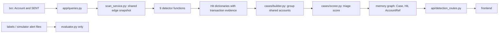

# RingTrace Detector Guide

This guide describes the code currently in this repository. Structural matches are investigation leads; they are not proof of money laundering.

## 1. What the detection system does

RingTrace represents each account as an `Account` node and each transfer as a directed `SENT` edge. Detector functions inspect the transaction graph and return evidence-bearing hits. The scan service combines hits that share accounts into cases and assigns each case a 0–100 triage priority. An analyst or the investigation agent can then inspect that evidence. Neither a detector hit nor the score is a final fraud decision; the score is not a probability.

## 2. Architecture and execution flow



- `backend/app/db.py` is the FalkorDB client and query logger.
- Detection, account, ingestion, and case queries are defined in `backend/app/queries.py`; Member B's memory operations are in `backend/app/queries_memory.py`.
- `backend/app/detectors/graph_pattern_utils.py` pages and normalizes transaction evidence. The scan coordinator reads one bounded snapshot (up to 250,000 rows), fetches account types, and passes the snapshot to each detector.
- `backend/app/scan_service.py:DETECTOR_REGISTRY` is the actual nine-pattern `/scan` registry. Detector results, including truncation reasons, are recorded individually. The case builder receives the normalized hits, groups by shared account, scores, and upserts cases into the configured memory graph.
- Case endpoints and supplementary detector endpoints are in `backend/app/api/detection_routes.py`, with response models in `backend/app/api/models.py`. The router is mounted by `backend/app/main.py`; legacy `/api/...` routes are also retained.
- Ground truth is loaded and compared only in `backend/app/evaluator.py`. The evaluation endpoint shares one transaction snapshot between the detector evaluations; it reads labels independently for matching.

`run_algorithm` in `backend/app/mcp_server/tools.py` is a separate Member B investigation tool. It accepts `pagerank`, `community`, `labelpropagation`, `connected_components`, and `wcc`; it does not run any of the nine fraud detectors. The fraud detector registry is `/scan`.

## 3. Detector inventory

| Pattern | Implementation and strategy | Main default rules | Evidence / case role | Tests and current verification |
|---|---|---|---|---|
| `cycle` | `detectors/cycle.py:detect_cycles`; bounded edge read, timestamp-ordered DFS, amount pruning, canonical edge rotation | 3–5 edges; 60-second to 13-hour hop gap; each next amount 0.89–1.05 of prior; review flag within 24 hours and >=0.80 min/max conservation | Ordered real edges, accounts, duration, retention and canonical ID; normal case hit | `test_cycle_algorithm_unit.py` (including `cycle_positive.json` and `cycle_negative.json`), `test_cycle_detector.py`; PASS, seed 43: 6/10 suspicious exact TP, 0/12 benign FP |
| `fan_in` | `detectors/fan_in.py:detect_fan_in`; candidate query plus rolling recipient bursts | >=8 distinct senders in 48 hours; near-threshold amount band `(42,500, 49,500)`; suspicion considers >=25% band share, >=15% with >=8 senders, or rapid non-merchant convergence | Actual inbound transactions, sender/receiver roles, amount share and type; case-generating | `test_fan_detectors.py`; PASS, seed 43: 8/10 TP, 0/12 FP; partial at 50 candidates |
| `fan_out` | `detectors/fan_out.py:detect_fan_out`; candidate query plus rolling origin bursts and type-agnostic recurring-batch comparison | >=8 distinct receivers in 48 hours; same near-threshold band; recurring payroll checked across 20–40 days | Actual outgoing transactions, recipients, structuring and recurrence measurements; case-generating | `test_fan_detectors.py`; PASS, seed 43: 3/10 TP, 3/6 FP; partial at 50 candidates |
| `relay_chain` | `detectors/relay_chain.py:detect_relay_chains`; bounded DFS of simple directed paths | 3–6 hops; <=6-hour gaps; structural retention 0.70–1.25; suspicious requires <=24 hours and every hop 0.80–1.05 | Every edge in the path, per-hop gaps/ratios, ordered roles; case-generating | `test_graph_pattern_detectors.py`; PASS, seed 43: 10/10 TP, 0/6 FP |
| `scatter_gather` | `detectors/scatter_gather.py:detect_scatter_gather`; group time-valid two-hop paths by shared source and sink, episode partitioning | >=3 intermediaries; <=24-hour leg delay; structural path ratio 0.50–1.25; 72-hour episode; suspicious ratio 0.80–1.05 per leg | Chosen actual two-edge path per intermediary, roles and individual ratios; case-generating | `test_graph_pattern_detectors.py`; PASS, seed 43: 10/10 TP; dataset has no benign examples |
| `gather_scatter` | `detectors/gather_scatter.py:detect_gather_scatter`; form direction-specific activity batches around a shared hub | >=3 incoming and >=3 outgoing counterparties; max 12-hour quiet gap; 72-hour window; scatter starts after gather; suspicion needs >=5 each side | Separate inbound/outbound edges and totals; explicitly does not attribute particular funds; case-generating | `test_graph_pattern_detectors.py`; PASS, seed 43: 7/10 TP; partial at 50; no benign examples |
| `bipartite` | `detectors/bipartite.py:detect_bipartite`; enumerate source target-pairs and group sources that share pairs | >=3 sources, >=3 shared targets, each pair shared by >=2 sources, density >=0.50; caps search and candidate groups | Actual source-to-target edges and density; always `suspicious=false`, supporting evidence only | `test_supplementary_detectors.py`; fixture PASS; seed 43: 0/10 exact matches, partial |
| `dense_cluster` | `detectors/dense_cluster.py:detect_dense_clusters`; rank one-hop ego-neighbors by degree, deduplicate groups, measure directed unique-pair density | 5–60 accounts; >=10 internal transactions; >=0.10 structural density; suspicious at >=max(configured density, 0.25); **no time window** | Actual internal transfer rows and pair density; can form a case if marked suspicious | `test_supplementary_detectors.py`; fixture PASS; seed 43: 0/10 exact matches, partial |
| `hub_account` | `detectors/hub_account.py:detect_hub_accounts`; log1p unique degree z-score across the observed snapshot plus total inflow/outflow ratio | >=10 counterparties, z>=3, ratio 0.5–2.0; **no time window** | Hub ID, degree, balance, up to 59 counterparties and supporting edge evidence; never suspicious itself, hub-only groups do not create cases | `test_supplementary_detectors.py`; fixture PASS; no labeled scenarios, `not_evaluable` |

`test_graph_pattern_detectors.py` and `test_supplementary_detectors.py` run fixtures on a disposable `test_...` FalkorDB graph and compare supporting transaction IDs. Cycle and fan fixtures have dedicated test modules. All nine are registered in `/scan`; supplementary patterns also have dedicated Member A API routes. The older `/api` detector endpoints in `main.py` expose cycle, both fans, relay, scatter-gather, and gather-scatter.

## 4. Detector details

All examples below are fictional illustrations, not production observations. All detectors consume `Account`/`SENT` evidence and return account IDs, transaction IDs, measured properties, an explanation, and truncation metadata (where the result class supports it). Path detectors preserve parallel transfers as distinct edges. No detector imports the evaluator or reads labels.

### Cycle

- **Meaning/example:** funds return to an earlier account: `A -TX1-> B -TX2-> C -TX3-> A`.
- **Algorithm/logic:** page up to 250,000 transaction rows; normalize them; index outgoing edges by source and timestamp; depth-first search from each origin; prune by strictly increasing timestamps, hop gap and adjacent amount ratio; rotate edge sequence to a canonical transaction ID so rotations deduplicate.
- **Rules:** 3–5 transfers, 60 seconds–13 hours between hops, adjacent ratio 0.89–1.05. A returned structure is only marked suspicious when it finishes within 24 hours and minimum/maximum edge amount is at least 0.80. Search is capped at 1,000,000 steps; output default 50, max 200.
- **Pseudocode:** `for origin: search chronological outgoing edges; prune bad gaps/ratios; if path closes at origin: canonicalize and measure; flag only if fast and conserved`.
- **False-positive limits/source/tests:** slow and unordered shapes can still be structural candidates but are not automatically suspicious. See `backend/app/detectors/cycle.py`, `backend/app/queries.py:GET_CYCLE_EDGES`, and the cycle tests above. Current seed-43 recall is 6/10 suspicious despite 10/10 structural recovery.

### Fan-in

- **Meaning/example:** many accounts converge on one recipient: `A,B,C,... -> X`.
- **Algorithm/logic:** query candidate recipients by distinct sender count; fetch or reuse their incoming history; create maximal merged rolling windows while preserving multiple transfers from one sender; compute near-threshold share, volume, timing and account type.
- **Rules:** default 8 distinct senders / 48 hours. Suspicion: >=25% transfers in the configurable `(42,500,49,500)` rupee band; or >=8 senders in <=24 hours for a non-merchant; or >=15% band share with >=8 senders. A merchant with zero band share is treated as benign context.
- **Pseudocode:** `for recipient: find qualifying windows; keep actual edges; compute band_share; apply the explicit suspicion rules`.
- **False-positive limits/source/tests:** merchant context does not suppress a structuring signal; background labels are incomplete. See `fan_in.py`, `queries.py` fan-in queries, and `test_fan_detectors.py`. Seed-43 has 0 labeled benign FPs, but 2 fraud FNs and a capped result.

### Fan-out

- **Meaning/example:** one account disperses payments: `X -> A,B,C,...`.
- **Algorithm/logic:** query candidate origins; find rolling bursts by distinct recipient; compare qualifying bursts with other outgoing history for recurring-batch similarity (the helper does not require the origin type to be `payroll`).
- **Rules:** default 8 recipients / 48 hours. Band-share and rapid-dispersal rules mirror fan-in. The recurrence helper treats a second >=8-recipient batch 20–40 days away, >=70% receiver overlap, transaction-count ratio 0.75–1.25 and median-amount ratio 0.75–1.25. A matching recurrence suppresses suspicion only when band share is below 25%, regardless of the account type.
- **Pseudocode:** `for origin: find bursts; test monthly batch similarity; compute band_share; classify with recurrence and speed rules`.
- **False-positive limits/source/tests:** payroll type alone is not an exemption. The measured 3/6 benign FPs and 3/10 recall on seed 43 are a meaningful unresolved issue, not something to hide by tuning on that seed. See `fan_out.py`, fan-out queries, and `test_fan_detectors.py`.

### Relay chain

- **Meaning/example:** a value-like sequence passes through accounts: `A -> B -> C -> D`.
- **Algorithm/logic:** timestamp-index outgoing edges; depth-first enumerate simple directed paths; prune reused accounts, non-increasing time, excessive delay and implausible amount ratios; create a hit for each eligible path length.
- **Rules:** 3–6 hops; <=6 hours between adjacent transfers; structural adjacent ratio 0.70–1.25. Suspicious requires total duration <=24 hours and each ratio 0.80–1.05. Search capped at 1,000,000 steps.
- **Pseudocode:** `extend a path only with a later edge to a new account; measure every path at length >=3; sort suspicious first`.
- **False-positive limits/source/tests:** path continuity is structural, not proof that the exact fungible money was traced. See `relay_chain.py` and `test_graph_pattern_detectors.py`; seed 43 recovered 10/10 fraud and 0/6 benign near misses.

### Scatter-gather

- **Meaning/example:** several routes split from the same source and converge at one sink: `A -> B1 -> Z`, `A -> B2 -> Z`, `A -> B3 -> Z`.
- **Algorithm/logic:** join actual first/second edges through an intermediary in Python; require ordered timestamps and amount constraints; group by `(source,sink)`; split repeated behavior into episodes; retain one deterministic best route per intermediary per episode.
- **Rules:** 3+ intermediaries; <=24-hour leg; 72-hour episode; structural retention 0.50–1.25 and suspicious retention 0.80–1.05 on every selected route. Search cap 500,000.
- **Pseudocode:** `for each first edge, inspect later outgoing edges at its destination; group valid routes by endpoints and episode; flag when every selected route retains enough`.
- **False-positive limits/source/tests:** multiple route totals do not prove individual funds were traced; seed 43 has no benign labeled examples, so FPR is unavailable. See `scatter_gather.py` and its tests.

### Gather-scatter

- **Meaning/example:** accounts pay into a hub and it later pays other accounts: `A,B,C -> H -> D,E,F`.
- **Algorithm/logic:** split inbound and outbound histories into batches when quiet gaps or total span exceed limits; pair batches at a common hub; require the outbound batch to start after the inbound batch ends.
- **Rules:** >=3 distinct counterparties in each direction; <=12-hour gaps; maximum 72-hour span. Suspicious additionally requires >=5 each direction and <=72 hours. Inflow/outflow totals are measured independently.
- **Pseudocode:** `make inbound and outbound batches; pair batches at each hub; keep only later scatter within 72h; report both totals separately`.
- **False-positive limits/source/tests:** no claim that an outgoing edge spends a particular incoming transfer. Seed 43 has 7/10 TP and is result-capped at 50; no benign examples. See `gather_scatter.py` and its tests.

### Bipartite

- **Meaning/example:** a group repeatedly pays a shared target set: `A,B,C -> X,Y,Z`.
- **Algorithm/logic:** record each source's distinct targets; enumerate target pairs per source; aggregate sources per pair; derive groups sharing pairs; calculate unique directed source-target pair density and return all actual matching transfers.
- **Rules:** default 3 sources, 3 targets, each shared by at least 2 sources, density >=0.50. At most 500,000 pair steps, 1,000 candidate groups and 60 source accounts per returned group; default output limit 50.
- **Pseudocode:** `enumerate each sender's target pairs; group senders by shared pairs; measure rectangle density; return structural evidence`.
- **False-positive limits/source/tests:** currently hard-coded `suspicious=false` because there is no calibrated fraud criterion; it is supporting evidence and cannot independently raise a case. Seed 43 exact match was 0/10 and the search/result was partial. See `bipartite.py` and supplementary tests.

### Dense cluster

- **Meaning/example:** several accounts have many transfers within their local group: `A <-> B,C,D,E` with repeated directed pairs inside the group.
- **Algorithm/logic:** build undirected neighbor sets for membership and directed outgoing lists for evidence; for each center select itself plus highest-degree neighbors; deduplicate exact account groups; count unique directed pairs and internal transaction rows.
- **Rules:** 5–60 accounts by default; at least 10 internal transfer rows; density is unique directed pairs divided by `n*(n-1)`; structural minimum 0.10 and suspicious threshold at least 0.25. Work cap is four times `max_edges`; edge sample cap is 250,000.
- **Pseudocode:** `for each high-degree center: form a bounded ego group; count internal directed pairs; emit when density and transaction count pass`.
- **False-positive limits/source/tests:** the code analyzes the entire fetched snapshot without a time window or community detection, unlike the documented target recipe. The target meaning of a suitable temporal window is not specified, so no new interval was invented. Seed 43 has 0/10 exact matches and partial search. See `dense_cluster.py` and supplementary tests.

### Hub account

- **Meaning/example:** one account has unusually many counterparties and balanced total flow: `many accounts -> H -> many accounts`.
- **Algorithm/logic:** count unique in/out counterparties, compute z-score of log(1+degree) across the fetched edge sample, calculate total received/sent ratio, and preserve a bounded counterparty evidence list.
- **Rules:** >=10 counterparties, z-score >=3 and inflow/outflow ratio 0.5–2.0. No time window. Evidence lists at most 59 counterparties. Every hit is `suspicious=false` and supporting-only.
- **Pseudocode:** `measure each account's unique degree and balance; compare log degree with sample population; emit only balanced outliers as context`.
- **False-positive limits/source/tests:** high activity alone never makes a case; the case builder drops hub-only groups and the scorer uses hub as corroboration. No labels exist for this pattern, so it is not evaluable. See `hub_account.py` and supplementary tests.

## 5. How detectors work together

`DETECTOR_REGISTRY` executes the nine patterns sequentially on one immutable edge snapshot. Each hit preserves `hit_id`, `pattern`, `account_ids`, `tx_ids`, transaction rows, `account_roles`, measurements and explanation. The cycle detector's legacy candidate fields are normalized to this common shape by the scan service.

`cases/builder.py:group_hits` uses union-find to connect hits sharing any account. It preserves the hit evidence and splits oversized packs at the configured 60-account cap; hits larger than the cap are reported as skipped. Hub-only components are omitted. `build_cases` calculates a stable ID from sorted account IDs and a similarity signature from patterns, account-type mix and size bucket. `persist_cases` uses `MERGE` upserts in the memory graph and does not overwrite an existing `Case.status`.

`cases/scorer.py:score_case` produces the breakdown `severity + amount + velocity + account_count + corroboration`, capped at 100. Pattern severity is a hard-coded map; merchant/payroll origin context subtracts 10. Amount uses a logarithmic heuristic, velocity uses transaction time span, and corroboration adds points for distinct patterns plus a small supporting hub bonus. Labels: low <40, medium 40–69, high >=70. This is a priority heuristic, not calibrated risk.

## 6. Thresholds and tuning

Thresholds are function defaults in detector modules and selected API parameters. They are explicit hard-coded heuristics, not learned percentiles. Fan structuring band is simulator-oriented; it is not a universal legal threshold. Evaluation labels must remain separate from detection. Project guidance designates seed 42 for development and seed 43 for independent reporting. This audit only evaluated seed 43; it did not tune thresholds against it. A meaningful tuning process still needs a documented seed-42 experiment and a separate final holdout.

## 7. Testing guide

From `backend/`, activate `.venv` or invoke its Python directly:

```powershell
.\.venv\Scripts\python.exe -m unittest discover -s tests -v
```

The project uses Python `unittest` (not pytest in the checked-in dependency set). Focused modules include `test_cycle_algorithm_unit.py` (including `cycle_positive.json` and `cycle_negative.json`), `test_cycle_detector.py`, `test_fan_detectors.py`, `test_graph_pattern_detectors.py`, `test_supplementary_detectors.py`, `test_case_grouping.py`, `test_case_scorer.py`, `test_case_persistence.py`, `test_api_integration.py`, and `test_evaluator_metrics.py`.

Fixtures under `backend/tests/fixtures/` are JSON account and transaction lists. Integration tests load them into UUID-suffixed `test_...` graphs, assert exact supporting IDs and behavior, and delete test graphs. A test failure should be treated as either a code assertion failure or a database/setup failure; verify FalkorDB is available on the configured host/port before diagnosing graph tests. Never substitute `txn` or `labels` as a test graph. For new tests, add a positive case, a realistic negative/boundary case, evidence-ID assertions, and cleanup in `finally`/teardown.

## 8. Known limitations and verified discrepancies

- Seed-43 output limits make fan-in, fan-out, gather-scatter, bipartite and dense-cluster reports partial at default evaluation limit 50. A reported FN in a partial report is not necessarily a final detector miss.
- Fan-out has 3 false positives on 6 labeled benign scenarios and only 3/10 suspicious fraud matches on this run. It needs a separate development-split analysis; seed 43 must not be used to tune it.
- Bipartite always emits structural-only hits and has no fraud-classification rule. Dense-cluster produced no exact planted matches in this evaluation.
- Hub-account has no ground-truth labels and is deliberately a non-suspicious support signal.
- Dense-cluster and hub-account have no temporal window; dense-cluster also uses local ego-neighborhood ranking rather than components/community detection. This differs from the intended time-windowed target design.
- The `/contract` directory and generated OpenAPI example-validation suite described in project instructions are absent. Pydantic response models exist, but there is a shape difference: detector transaction timestamps are Unix integers, while the written examples show ISO strings; `TransactionModel.ts` permits either.
- Legacy detector endpoints in `main.py` do not declare response models; Member A routes in `api/detection_routes.py` do.
- `mcp_server/tools.py` contains inline Cypher. It is Member B-owned and was not changed during this audit; centralizing those queries requires coordination with that owner.
- Fraud detectors are not exposed through `run_algorithm`; it dispatches investigation algorithms only. All nine fraud patterns are executed by `/scan`.
- Scenario injection requires `RINGTRACE_DEMO_KEY`. Event delivery to the Member B stream is not part of the Member A detector pipeline.
- Synthetic data is generated by this repository's simulator; these results do not establish real-world fraud-detection accuracy.

## 9. Honest performance reporting

Precision is the fraction of matched suspicious candidates that are labeled fraud within the explicitly labeled scenarios. Recall is the fraction of labeled fraud scenarios matched suspiciously. F1 combines precision and recall. False-positive rate is measurable only when labeled benign examples exist. Unmatched background hits are unknown, not automatically false positives. Exact matching requires both account and transaction ID sets; each label is matched at most once. Truncated results are marked partial. Latency is the evaluator's detector execution measurement, not end-to-end deployment latency.

Fresh seed-43 run for this audit: 3,000 accounts, 39,924 transactions, 116 alerts, loaded into disposable `test_...` graphs and removed after evaluation. Results: cycle 6/10 TP, 0/12 FP; fan-in 8/10, 0/12; fan-out 3/10, 3/6; relay-chain 10/10, 0/6; scatter-gather 10/10 with zero benign labels; gather-scatter 7/10 with zero benign labels; bipartite 0/10 exact matches; dense-cluster 0/10; hub-account not evaluable. Several results were partial at the configured candidate limit. Do not interpret 1.00 precision for a pattern with no benign labels as an estimated false-positive rate.

## 10. Judge-ready explanation

**Short explanation:** “We read directed transfer evidence once, then run bounded graph-pattern detectors that return the exact accounts and transaction IDs behind each lead. Hits sharing accounts are grouped into cases and ranked with an explainable triage score. Ground truth is only used by a separate evaluator, and the score does not claim a probability of fraud.”

- **Why use both graph structure and time?** A cycle or relay shape alone can describe legitimate activity. The time and amount checks add context, and the output still says candidate for review.
- **How do you avoid claiming money was traced through a hub?** Gather-scatter reports inbound and outbound rows and totals separately; it explicitly does not attribute a particular outgoing transfer to a particular incoming one.
- **What does a score of 80 mean?** It is a bounded heuristic priority score from five visible components, not an 80% chance of fraud.
- **How are false positives measured?** Exact account-and-transaction evidence is matched one-to-one against labeled synthetic fraud and benign examples; unknown background candidates are excluded. Missing benign labels make FPR unavailable.
- **What are the weakest verified areas?** Fan-out and the two dense structural patterns need more development-set analysis; bounded result caps make some evaluation reports partial.

## 11. Verification checklist

| Check | Status | Evidence |
|---|---|---|
| All nine target detectors exist and `/scan` registers them | PASS | `backend/app/scan_service.py:DETECTOR_REGISTRY`; source modules |
| `run_algorithm` invokes fraud detectors | NOT IMPLEMENTED | It dispatches PageRank/community/component analysis; `/scan` dispatches fraud detectors |
| Positive and negative fixture coverage for all nine | PASS | Fixture files and detector test modules; full suite below |
| Returned hit transaction evidence and common shape | PASS for exercised fixture/integration paths | Detector tests, scan integration tests |
| Bounded scans/search and visible truncation | PASS for implemented caps | Detector result metadata and cap tests; some seed-43 runs are partial |
| Detector ground-truth isolation | PASS by source inspection | No label/alert references in detector modules; evaluator is separate |
| Cypher parameterized in query layer for Member A routes/detectors | PASS by source inspection | `backend/app/queries.py`; Python detectors use normalized snapshots |
| All Cypher centralized across repository | PARTIAL | Member B's `backend/app/mcp_server/tools.py` still has inline queries |
| Case grouping, score and idempotent persistence | PASS | Case tests and API integration tests |
| API contract examples validated against models | NOT TESTED / BLOCKED BY MISSING ARTIFACT | No `/contract` directory; timestamp example mismatch noted above |
| Full backend regression | PASS | `.venv\\Scripts\\python.exe -m unittest discover -s tests -v`: 177 tests passed (final run recorded in project status) |
| Seed-43 honest evaluation | PASS WITH LIMITATIONS | Isolated-graph run described in Section 9; thresholds were not tuned |

### Standard review checklist summary

| Checklist area | Status | Evidence / exceptions |
|---|---|---|
| A. Algorithm and graph logic | PARTIAL | Fixture and boundary tests pass. Dense-cluster has no temporal window and its documented target meaning is ambiguous; it is recorded as a gap rather than assigned an arbitrary window. |
| B. Evidence correctness | PASS FOR EXERCISED PATHS | All detector fixture tests check structural output; cycle fixtures now assert exact account and transaction sets; API and case integration tests preserve transaction evidence. |
| C. Cypher and database safety | PASS FOR MEMBER A DETECTORS; PARTIAL REPOSITORY-WIDE | Member A detector reads use query constants and parameterized inputs; bounded/invalid row conditions are surfaced. Inline Cypher remains in Member B's MCP tool module and was not edited. |
| D. Fraud classification and thresholds | PARTIAL | Structural and suspicion flags are separated; hub and bipartite are support-only. Thresholds are heuristics, not calibrated. Fan-out has labeled benign FPs; dense-cluster's suspiciousness rule lacks demonstrated seed-43 exact recall. |
| E. Integration and case building | PASS FOR `/scan` AND CASE PIPELINE | All nine appear in `DETECTOR_REGISTRY`; isolated integration tests cover scan, persistence, idempotency, API models and aliases. `run_algorithm` is an investigation algorithm tool, not detector dispatch. |
| F. Security and ground-truth isolation | PASS BY SOURCE INSPECTION | Detector modules contain no label/alert/ground-truth references; only evaluator loads labels. Evaluation ran with disposable graphs, which were deleted. |
| G. Testing and maintainability | PASS WITH KNOWN LIMITS | Full 177-test suite passed. Every pattern has positive and negative fixture/test coverage. Evaluator caps cause partial reports for several patterns. |

The confirmed test-coverage gap for cycle was fixed by adding positive and realistic slow-cycle negative fixtures with evidence assertions. Detector implementation behavior was left unchanged because the remaining findings are evaluation limitations or design/contract discrepancies that require a separate development split or an agreed semantic/compatibility decision.
