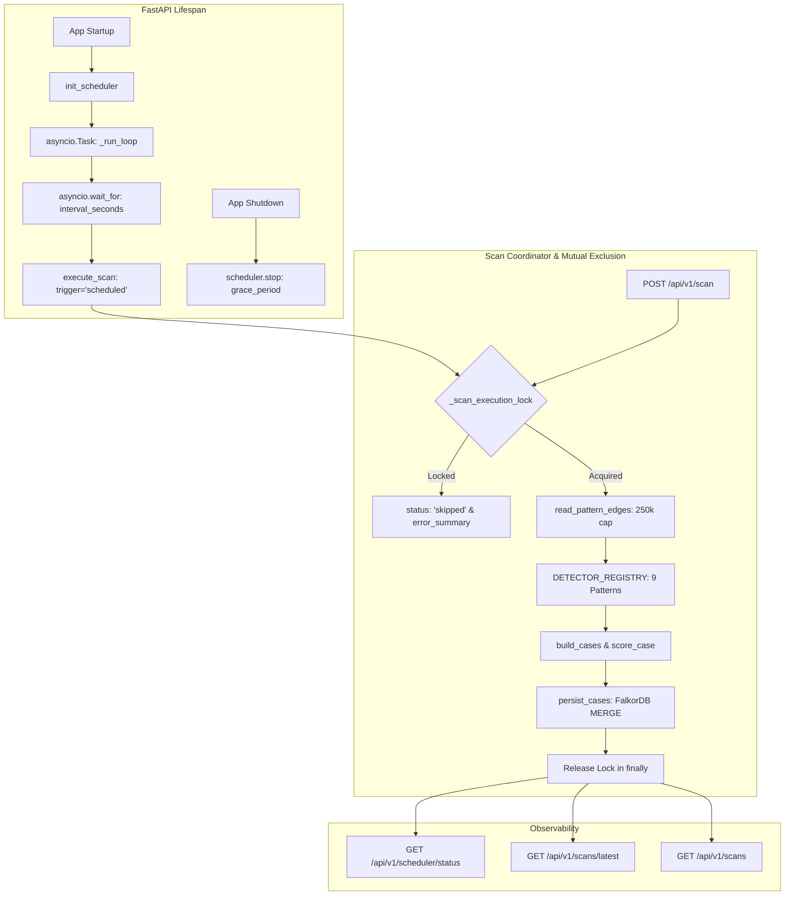

# RingTrace Fraud Detection Scheduler & Concurrency Coordinator

This document details the architecture, configuration, concurrency controls, and lifecycle behavior of the RingTrace automated fraud detection scheduler.

---

## 1. Why Periodic Scanning is Required

In modern financial crime and money-laundering detection, illicit flows rarely happen instantaneously in a single batch. Typologies such as structuring (fan-in), pass-through mule networks (relay chains), and layered dispersal (scatter-gather) evolve over hours, days, or weeks:

- **Incremental Ingestion:** As transactions flow into FalkorDB via live streams or batch settlement pipelines, new accounts and edges link previously fragmented subgraphs.
- **Continuous Vigilance:** Rather than requiring compliance analysts to manually trigger `/scan` after each transaction batch, the periodic scheduler ensures that all 9 registered graph detection typologies are continuously evaluated.
- **Temporal Completeness:** Overlapping observation windows detect multi-stage laundering cycles even if individual transfer legs cross scheduled run boundaries.

---

## 2. Scheduler Architecture

The scheduler follows a lightweight, robust single-process architecture integrated with the FastAPI lifespan:



### Core Components

1. **`SchedulerConfig` (`backend/app/scheduler/config.py`):**
   Environment-driven configuration validator with strict typing and negative/zero boundary checks.
2. **`DetectionScheduler` (`backend/app/scheduler/service.py`):**
   Pure Python `asyncio` periodic task runner. Wakes up reliably, dispatches executions into threadpool workers (`asyncio.to_thread`), and cancels cleanly upon shutdown without blocking the event loop.
3. **`ScanCoordinator` (`backend/app/scan_service.py`):**
   Unified execution pipeline shared between scheduled iterations and manual API `/scan` requests. Enforces atomic mutual exclusion and records execution diagnostics.
4. **`FastAPI Lifespan` (`backend/app/main.py`):**
   Native lifespan context manager managing startup initialization and clean shutdown without conflicting secondary hooks.

---

## 3. Shared Pipeline: Manual & Scheduled Compatibility

Both scheduled runs and manual `/api/v1/scan` calls route through the exact same coordinator function (`run_scan` / `execute_scan`).

- **Same Registry:** Executes the authoritative `DETECTOR_REGISTRY` in `scan_service.py` (9 patterns: `cycle`, `fan_in`, `fan_out`, `relay_chain`, `scatter_gather`, `gather_scatter`, `bipartite`, `dense_cluster`, `hub_account`).
- **Same Case Builder & Scorer:** Hits are partitioned into connected clusters under the 60-account cap, scored (0–100 triage priority), and assigned deterministic `CASE_{sha256(sorted(accounts))[:12]}` identifiers.
- **Contract Preservation:** The manual `POST /api/v1/scan` endpoint continues returning HTTP 202 `ScanReceipt` with `scan_id` and `status`.

---

## 4. Concurrency & Overlap Prevention

**Rule:** A new scheduled or manual scan must never execute while another scan is actively running against FalkorDB.

### Synchronization Mechanism

- **Non-blocking Execution Lock:** `_scan_execution_lock = threading.Lock()` with `acquire(blocking=False)`.
- **Active Scan Tracking:** `_active_scan_id` protected by `_active_scan_id_lock`.
- **Policy on Trigger Overlap:** **Skip and Record.**
  - If a scheduled or manual trigger occurs while a scan is active, it does **not** queue an unbounded backlog.
  - A unique `scan_id` is generated, and the run record is immediately stamped with `status: "skipped"` and `error_summary: "Scan skipped: another scan (<active_id>) is currently executing"`.
- **Guaranteed Lock Release:** The lock is acquired inside a `try ... finally:` block, ensuring immediate and reliable release even if detectors or database drivers crash.

---

## 5. Time Windows & Pattern Completeness

Laundering patterns span multiple time intervals (e.g. 20–40 day payroll recurrence, 48h fan-in bursts, 72h scatter-gather episodes).

- **Bounded Graph Snapshot:** `read_pattern_edges` pages through up to 250,000 transaction edges ordered deterministically by `(ts, tx_id)`.
- **Full-Spectrum Lookback:** By default (`DETECTION_SCAN_LOOKBACK_SECONDS=None`), the snapshot spans the complete active graph history up to the safety limit. Full-graph structural algorithms (`dense_cluster` and `hub_account`) evaluate structural density without artificial time truncation.
- **Effective Scan Window:** Each scan record computes and stores:
  - `effective_window_start`: Minimum transaction timestamp in ISO-8601 UTC.
  - `effective_window_end`: Maximum transaction timestamp in ISO-8601 UTC.
- **Idempotency Guarantee:** Because case IDs are deterministic and persistence uses openCypher `MERGE (c:Case {id: ...}) ON CREATE SET c.status = 'open'`, rescanning overlapping transaction windows **never duplicates cases or hits**, and preserves analyst triage decisions (`status`).

---

## 6. Failure Handling & Scan Isolation

- **Isolated Detector Errors:** If a single detector raises an exception, the coordinator logs the error in `detector_errors[pattern]`, increments `detectors_failed`, and continues executing the remaining detectors.
- **Status Classification:**
  - `complete`: All detectors ran successfully without truncation.
  - `partial`: One or more detectors encountered an error or hit search limits (`truncated=true`), but cases were still built from valid evidence.
  - `failed`: Fatal error occurred (e.g., FalkorDB disconnect during edge snapshot).
  - `skipped`: Scan trigger aborted because another scan was already executing.
- **Never Fake Success:** A partial run is explicitly marked as `partial` and never reported as `complete`.

---

## 7. Run Status & History Tracking

Each run record contains:

| Field | Description | Example |
|---|---|---|
| `scan_id` | Unique scan identifier | `SCAN_4a8f90c12e56` |
| `trigger` | Invocation source | `"scheduled"` or `"manual"` |
| `status` | Execution outcome | `"complete"`, `"partial"`, `"failed"`, `"skipped"` |
| `started_at` | UTC ISO-8601 start timestamp | `"2026-10-17T15:20:00Z"` |
| `finished_at` | UTC ISO-8601 finish timestamp | `"2026-10-17T15:20:02Z"` |
| `duration_ms` | Elapsed execution time | `1240.5` |
| `effective_window_start` | Earliest transaction scanned | `"2026-01-01T00:00:00Z"` |
| `effective_window_end` | Latest transaction scanned | `"2026-03-15T18:30:00Z"` |
| `detectors_completed` | List of successfully completed detectors | `["cycle", "fan_in", ...]` |
| `detectors_failed` | List of failed detectors | `[]` |
| `hits_found` / `hit_count` | Total detector evidence hits found | `14` |
| `cases_created_or_updated` | Number of cases saved into memory graph | `5` |
| `error_summary` | Human-readable explanation if failed/skipped | `null` |

> [!NOTE]
> Scan history is tracked in-memory up to `DETECTION_SCAN_HISTORY_LIMIT` (default: 100). History is reinitialized when the application restarts. Persistent case results, evidence, and scores remain permanently stored in the FalkorDB `memory` graph.

---

## 8. Configuration Reference

All settings are controlled via environment variables:

| Variable | Type | Default | Description |
|---|---|---|---|
| `DETECTION_SCHEDULER_ENABLED` | bool | `true` | Enables or disables periodic scheduler background task |
| `DETECTION_SCAN_INTERVAL_SECONDS` | int | `300` | Scheduling interval (default: 5 minutes, must be > 0) |
| `DETECTION_SCAN_ON_STARTUP` | bool | `false` | Whether to trigger an immediate scan pass on application startup |
| `DETECTION_SCAN_LOOKBACK_SECONDS` | int | `None` | Optional lookback window limit in seconds (default: full snapshot) |
| `DETECTION_SCAN_TIMEOUT_SECONDS` | int | `120` | Maximum execution timeout safeguard |
| `DETECTION_SCAN_HISTORY_LIMIT` | int | `100` | Maximum in-memory run records retained |

---

## 9. API Visibility & Observability Endpoints

All endpoints support both `/api/v1/...` and legacy `/api/...` paths:

### 1. `GET /api/v1/scheduler/status`
Returns scheduler diagnostics, active status, and latest run record:
```json
{
  "enabled": true,
  "running": true,
  "interval_seconds": 300,
  "scan_on_startup": false,
  "next_run_at": "2026-10-17T15:25:00Z",
  "last_run_at": "2026-10-17T15:20:00Z",
  "run_count": 3,
  "failure_count": 0,
  "skip_count": 0,
  "is_scan_active": false,
  "active_scan_id": null,
  "latest_scan": {
    "scan_id": "SCAN_4a8f90c12e56",
    "status": "complete",
    "trigger": "scheduled",
    "duration_ms": 1120.4,
    "hits_found": 12,
    "case_count": 4
  }
}
```

### 2. `GET /api/v1/scans/latest`
Returns the most recent scan record. Does not trigger a new scan.

### 3. `GET /api/v1/scans?limit=20`
Returns recent scan execution history sorted newest first.

### 4. `POST /api/v1/scan`
Triggers an immediate manual scan pass (returns HTTP 202). If a scan is currently active, returns `status: "skipped"`.

---

## 10. Startup and Shutdown Behavior

- **Startup:**
  - Validates all configuration variables.
  - Initializes the scheduler singleton.
  - If `DETECTION_SCHEDULER_ENABLED=true`, launches the `_run_loop` `asyncio.Task`.
  - Calculates `next_run_at` (`now + interval_seconds`).
  - If `DETECTION_SCAN_ON_STARTUP=true`, immediately runs an initial pass.
- **Shutdown:**
  - Signals `_stop_event.set()` to terminate the scheduler loop immediately.
  - Invokes `set_shutting_down(True)` on the scan coordinator to set the cooperative shutdown flag.
  - Ongoing scans check `is_shutting_down()` at each pattern detector boundary; if True, execution breaks early, marks `status="partial"`, and persists any cases found up to that point.
  - Waits up to `grace_period_seconds` (default: 10s) for the current detector or case persistence step to finish.
  - The `try ... finally:` block in `run_scan` guarantees immediate lock release and active ID clearance.
- **Unexpected Process Termination:**
  - If the process is killed (`SIGKILL`), FalkorDB graph state remains consistent because Cypher `UPSERT_CASES` queries are transactional. Any in-memory scan history for the aborted run is discarded upon restart.

---

## 11. Operational Cautions & Verification Against Actual Code

Before merging or deploying to production, the following technical verifications must be understood by engineering and operations:

### 1. Shutdown: In-Flight Scan Cannot Outlive Shutdown in an Unsafe State
- **Cooperative Interruption:** In `backend/app/scan_service.py`, `run_scan` checks `is_shutting_down()` before executing each pattern detector. When the FastAPI lifespan triggers `shutdown_scheduler(grace_period=10.0)`, `set_shutting_down(True)` is immediately set.
- **Detector Boundary Exit:** An in-flight scan will not continue running all remaining detectors. It completes its current detector, skips the rest, flags `status="partial"`, records `"shutdown"` in `detector_errors`, and persists cases found so far.
- **Guaranteed Lock Release:** The `try ... finally:` block in `run_scan` guarantees `_scan_execution_lock.release()` and clears `_active_scan_id`.
- **Database Safety:** FalkorDB openCypher `MERGE` queries execute atomically. No corrupted or half-written case nodes are left in the database.

### 2. Timeout: A Configured Timeout Does Not Forcefully Kill a Blocking Thread or DB Query
- **Asyncio vs. C/Socket Reality:** In `backend/app/scheduler/service.py`, `_execute_scheduled_pass` wraps the scan in `asyncio.wait_for(..., timeout=timeout_seconds)`. If the timeout expires, `asyncio.TimeoutError` is raised in the scheduler coroutine, allowing the scheduler loop to remain responsive.
- **Threadpool Continuation:** In Python, an operating system thread executing synchronous socket I/O (such as a FalkorDB Cypher query over TCP) or CPU-bound graph traversal cannot be forcefully killed without terminating the entire interpreter process.
- **Protection Against Duplicate Work:** If a timeout occurs, the worker thread continues running until its current database query or detector finishes. The `_scan_execution_lock` remains held. If the next scheduled iteration wakes up while the timed-out thread is still running, it will fail non-blocking lock acquisition and be recorded as `status: "skipped"` rather than overwhelming FalkorDB with overlapping scans.
- **Observability:** On timeout, the scheduler updates the active scan job's `error_summary` to indicate that the supervisory timeout threshold was reached while the query finishes in the background.

### 3. Detection Completeness: Bounded Snapshot & Search Limitations
- **250,000-Edge Snapshot Cap:** `read_pattern_edges` enforces `LIMIT 250000 ORDER BY t.ts, t.tx_id`. If the production graph contains more than 250,000 edges, edges beyond this limit are excluded from the current detection pass.
- **Detector Search Step Limits:** Algorithms such as cycle detection (`CYCLE_MAX_SEARCH_STEPS = 500_000`) and hub account detection enforce hard computational bounds to prevent exponential path exploration.
- **Partial vs Complete:** If any detector encounters its search limit or an error, it sets `truncated = True`, causing the overall scan pass to be stamped `status: "partial"`.
- **Observation Window:** The computed `effective_window_start` and `effective_window_end` reflect the minimum and maximum timestamps of edges present in the 250k snapshot, not the entire database history.
- **Honest Claim:** The scheduler does **not** guarantee 100% graph-wide detection completeness across infinite volumes. It provides bounded-latency, predictable heuristic triage with explicit truncation transparency.

### 4. Concurrency: In-Memory Lock is Single-Process Only
- **Process Scope:** `_scan_execution_lock = threading.Lock()` is an in-memory lock that protects only a single Python OS process.
- **Multi-Worker / Multi-Replica Deployments:**
  - If running Uvicorn with multiple workers (`uvicorn --workers 4`) or scaling horizontally across Kubernetes pods, each process maintains its own in-memory lock.
  - If `DETECTION_SCHEDULER_ENABLED=true` is enabled across all replicas, multiple schedulers will fire concurrently.
- **Deployment Requirement:**
  - **Single Scheduler Owner Pattern:** In multi-worker or multi-pod deployments, exactly one worker or dedicated scheduler container must have `DETECTION_SCHEDULER_ENABLED=true`. All other API replicas must have `DETECTION_SCHEDULER_ENABLED=false`.
  - **FalkorDB Write Safety:** Because case persistence uses deterministic case IDs and idempotent Cypher `MERGE` queries, concurrent writes will not corrupt data or produce duplicate cases, but single ownership is required to avoid unnecessary CPU/database contention.
  - **Distributed Coordination (Future):** For active-active multi-replica failover, an external distributed lock (e.g. Redis key `SET ringtrace:scheduler:lock <worker_id> NX EX 300`) can be layered into `scan_service.py`.

### 5. Manual Scan Response: HTTP 202 with status: "skipped"
- **Clear Client Contract:** When `POST /api/v1/scan` is called while another scan is active, the endpoint returns HTTP 202 Accepted with:
  ```json
  {
    "scan_id": "SCAN_xyz",
    "status": "skipped",
    "active_scan_id": "SCAN_abc",
    "message": "Scan skipped: another scan (SCAN_abc) is currently executing. Track progress at /api/v1/scan/SCAN_abc"
  }
  ```
- **Why HTTP 202?** HTTP 202 indicates the request was accepted and evaluated, but `status: "skipped"` signals that this requested job ID will not run detectors.
- **Client Handling:** Clients must inspect `receipt.status`:
  - If `status == "running"`, clients poll `/api/v1/scan/{scan_id}` until completion.
  - If `status == "skipped"`, clients must **not** poll `scan_id` expecting it to transition to "complete". Instead, clients should read `receipt.active_scan_id` to observe the scan that is actively doing the work.
- **Frontend Integration:** The RingTrace UI (`CaseManagementView.tsx`) checks `receipt.status`. If `'skipped'`, it displays an amber notice with `active_scan_id` and stops polling immediately without entering an infinite loop.

---

## 12. How to Run Scheduler Tests Locally

Run the dedicated scheduler test suite:
```bash
.venv\Scripts\python.exe -m unittest tests/test_scheduler.py
```

Run the full backend test suite:
```bash
.venv\Scripts\python.exe -m unittest discover -s tests -p "test_*.py"
```

---

## 13. Deployment Topology Reference

| Deployment Scenario | Configuration | Behavior |
|---|---|---|
| **Single Process (Dev / Default)** | `DETECTION_SCHEDULER_ENABLED=true` | 100% thread-safe; in-memory lock prevents any overlapping scheduled or manual scans. |
| **Multi-Worker Uvicorn (`-w 4`)** | Set `DETECTION_SCHEDULER_ENABLED=true` on worker 0 or use single-process entrypoint. | Schedulers in worker 1-3 should be disabled to prevent duplicate concurrent scheduled triggers. |
| **Kubernetes / Multi-Pod** | 1 Scheduler Pod (`DETECTION_SCHEDULER_ENABLED=true`) + N API Pods (`DETECTION_SCHEDULER_ENABLED=false`) | Dedicated scheduler pod drives periodic scans. API pods handle analyst queries and manual scans. Idempotent FalkorDB `MERGE` protects database integrity. |
